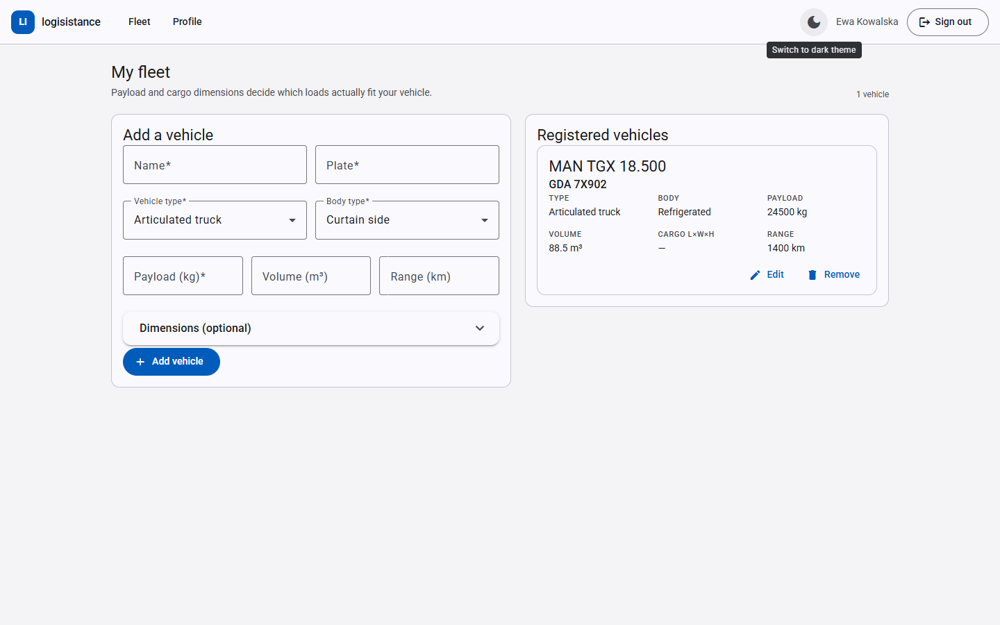
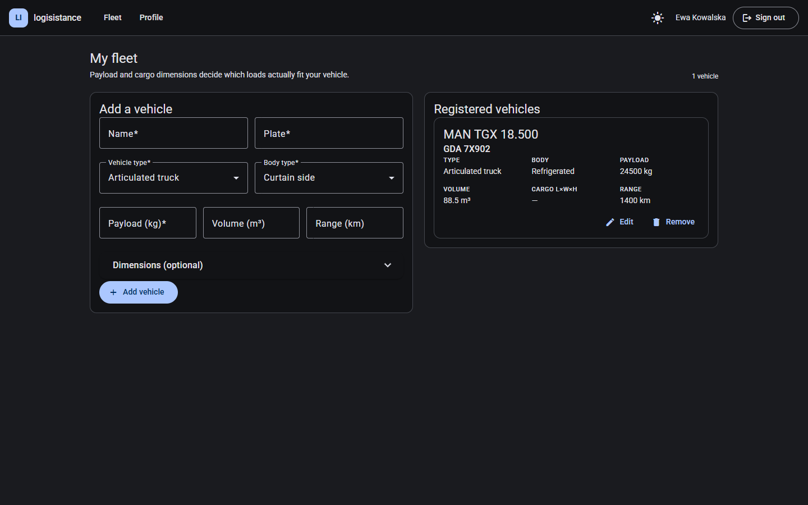
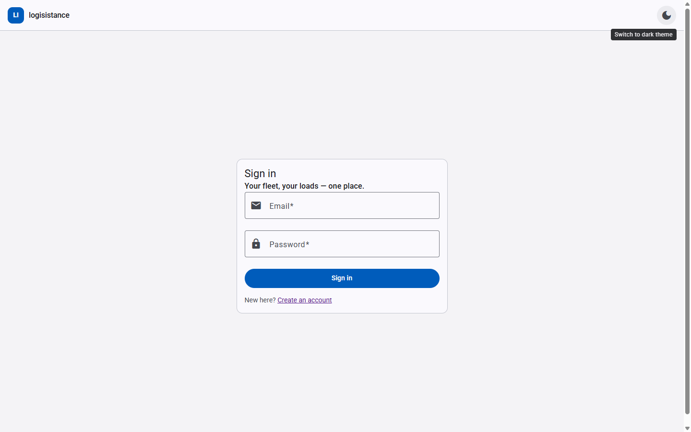
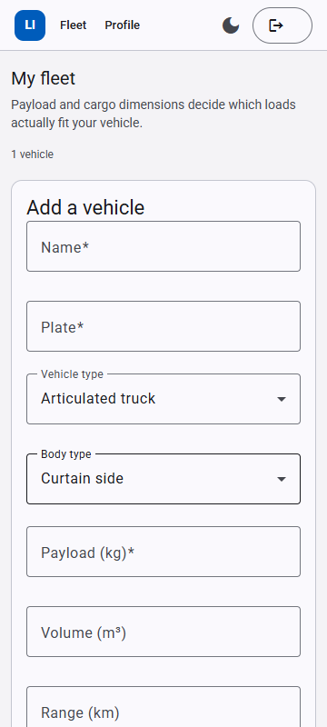

# logisistance-web

Angular client for **logisistance** — a logistics assistant for independent road freight carriers
in the European Union.

The API lives in a separate repository:
[`logisistance-api`](https://github.com/deniskoliban/logisistance-api) (FastAPI).

**Status:** v0.1 — sign up / sign in, driver profile and vehicle profiles, on Angular Material 3
with light and dark themes, Signal Forms and a responsive layout for phone, tablet and desktop.

## Stack

Angular 22 (standalone components, signals, zoneless) · Angular Material 22 + CDK ·
Signal Forms (`@angular/forms/signals`) · TypeScript 6 · Vitest (via `@angular/cli`)

## Run

```powershell
npm install
npm start          # http://localhost:4200
```

The dev server proxies `/api` to `http://127.0.0.1:8000` (see `proxy.conf.json`), so the API must
be running — see the
[API quick start](https://github.com/deniskoliban/logisistance-api#run).

```powershell
npm test           # 6 unit tests
npm run build      # production bundle
```

## Theming

Material emits its design tokens with the CSS `light-dark()` function, so the active palette
follows the CSS `color-scheme` property. That gives both themes from a single `mat.theme()` call:

- `src/styles.scss` sets up the palette (`mat.$azure-palette` primary, `mat.$blue-palette`
  tertiary), Roboto typography and density, and defines `html.light-theme` / `html.dark-theme`
  which only switch `color-scheme`.
- `ThemeService` (`core/services/theme.service.ts`) toggles those classes on `<html>`, persists
  the choice in `localStorage` under `logisistance.theme`, and defaults to the OS preference on
  first visit.
- The toggle button in the toolbar is rendered on every screen, including login.
- Everything is styled through Material system tokens (`--mat-sys-*`); there is no hand-written
  colour palette to keep in sync.

## Standing UI rules

These are not one-off decisions — every new screen has to follow them.

### Signal Forms for every form

Forms use `@angular/forms/signals`, not `ReactiveFormsModule`:

```ts
protected readonly model = signal<LoginModel>({ email: '', password: '' });

protected readonly loginForm = form(this.model, (path) => {
  required(path.email, { message: 'Email is required' });
  email(path.email, { message: 'Enter a valid email address' });
}, { submission: { action: async () => { /* call the API */ } } });
```

```html
<form [formRoot]="loginForm">
  <mat-form-field appearance="outline">
    <mat-label>Email</mat-label>
    <input matInput type="email" [formField]="loginForm.email" />
    @if (errorOf(loginForm.email); as message) {
      <mat-error>{{ message }}</mat-error>
    }
  </mat-form-field>
</form>
```

Conventions that follow from it:

- The model is a `signal`; the tree reads it, writes it, and stays the single source of truth.
- Validation lives in the schema function ("logic rules"), so field state, Material's error state and
  the native attributes are all derived from one place.
- `[formRoot]` on `<form>` handles `submit` (also on Enter) and runs `submission.action` only when
  valid; the pending flag is `form().submitting()`.
- `errorOf(field)` (`core/utils/form-error.util.ts`) returns the first message once a field is
  touched and invalid.
- After a successful create, reset with `model.set(...)` **and** `form().reset()` — the second call
  clears `touched`/`dirty`, otherwise the emptied form immediately flashes validation errors.
- Do **not** put `min`/`max` attributes on a `[formField]` input: Angular rejects it (NG8022). The
  bounds come from `min()`/`max()` in the schema. `step` and `type` are fine.

### Responsive on phone, tablet and desktop

Verified at 360 px, 768 px and 1440 px wide — always check all three before calling a screen done.

| Breakpoint | Behaviour |
| --- | --- |
| ≤ 900 px | `.split` becomes one column, page header stacks, the driver name leaves the toolbar |
| ≤ 620 px | 2/3-column form grids collapse to one column, "Sign out" becomes icon-only, smaller page padding |
| ≤ 400 px | nav links tighten, the profile identity block is hidden |

Rules of thumb used here: no horizontal scrolling at any width (checked with
`scrollWidth > clientWidth`), form fields always full width inside their grid cell, toolbars never
wrap into two rows, and anything decorative collapses before anything interactive does.

## File naming conventions

| Kind | Pattern | Example |
| --- | --- | --- |
| Component | `*.component.ts` + `.html` (+ `.scss` when needed) | `profile.component.ts` |
| Unit test | `*.spec.ts` next to the file | `app.component.spec.ts` |
| Service | `*.service.ts` | `auth.service.ts`, `fleet.service.ts`, `theme.service.ts` |
| Route guard | `*.guard.ts` | `auth.guard.ts`, `guest.guard.ts` |
| HTTP interceptor | `*.interceptor.ts` | `auth.interceptor.ts` |
| Pure helper | `*.util.ts` | `api-error.util.ts`, `form-error.util.ts` |
| API type | `*.model.ts` (+ barrel `index.ts`) | `vehicle.model.ts` |

Angular 22 would scaffold `app.ts`; this project uses the long-standing `*.component.ts`
convention instead, and keeps every file self-describing.

## Layout

```
src/
├── styles.scss                  # Material theme setup + layout helpers
├── main.ts
└── app/
    ├── app.component.ts|html|scss
    ├── app.config.ts            # providers (router, http + interceptor)
    ├── app.routes.ts
    ├── core/
    │   ├── auth/                # auth.service, auth.guard, guest.guard, auth.interceptor
    │   ├── fleet/               # fleet.service (vehicles + reference data)
    │   ├── models/              # user, vehicle, reference, auth models + barrel
    │   ├── services/            # theme.service
    │   └── utils/               # api-error.util, form-error.util
    ├── shared/
    │   └── confirm-dialog/      # Material dialog for destructive actions
    └── features/
        ├── auth/login/          # login.component
        ├── auth/register/       # register.component
        ├── profile/             # profile.component
        └── vehicles/            # vehicles.component
```

## Screens

Light and dark come from the same markup:

| Fleet (light) | Fleet (dark) |
| --- | --- |
|  |  |

| Sign in | Fleet on a 360 px phone |
| --- | --- |
|  |  |

## Behaviour

- Registration collects name, email, password, age (18–100), country (EU/EEA/CH, loaded from the
  API) and city; a successful sign-up signs the user in immediately.
- The JWT is attached by a functional interceptor to every `/api/...` request and survives a page
  reload through `localStorage`.
- `authGuard` protects `/profile` and `/vehicles` and remembers the attempted URL; `guestGuard`
  keeps signed-in users off `/login` and `/register`.
- Destructive actions go through a Material dialog, results through `MatSnackBar`, server errors
  through a readable inline message (FastAPI validation details are flattened).
- The vehicle form reuses one signal form for create and edit; optional dimensions live in a
  `mat-expansion-panel` so the common path stays short.

## Roadmap

Freight search, route planning and backhaul matching come next. The API types in
`core/models` are currently written by hand; once the contract starts moving they should be
generated from the API's `/openapi.json` with `openapi-typescript`.
