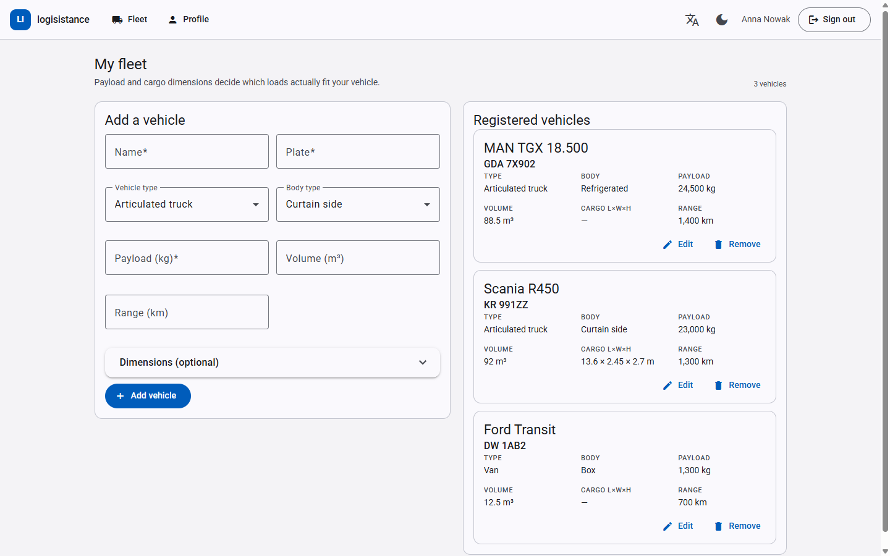
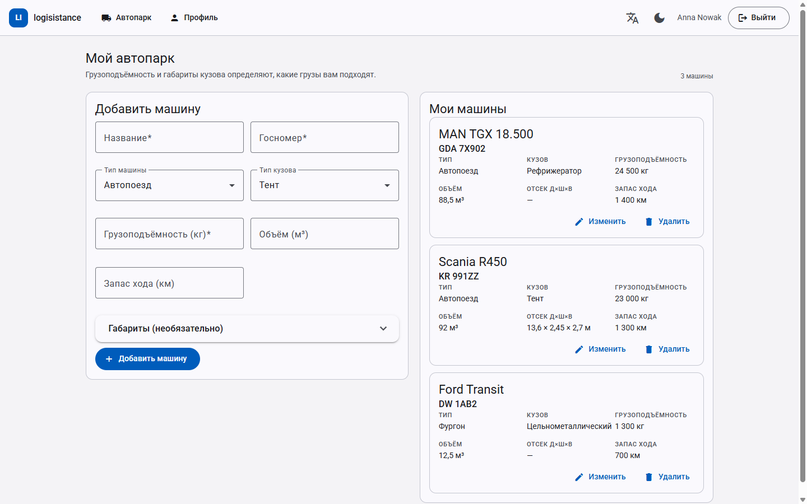
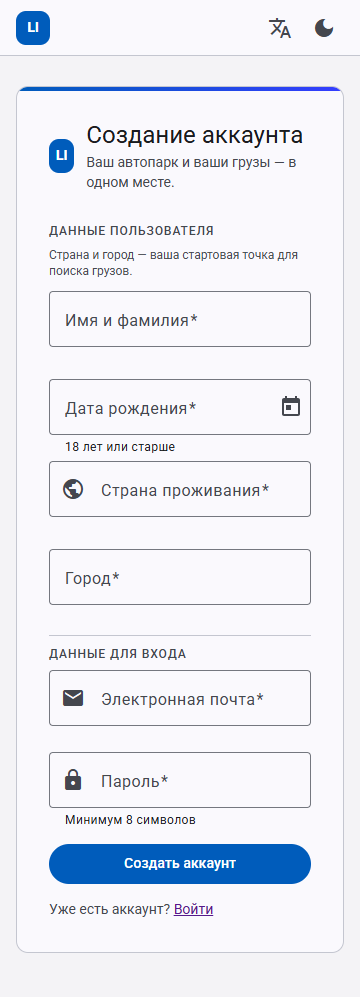

# logisistance-web

Angular client for **logisistance** — a logistics assistant for independent road freight carriers
in the European Union.

The API lives in a separate repository:
[`logisistance-api`](https://github.com/deniskoliban/logisistance-api) (FastAPI).

**Status:** v0.1 — sign up / sign in, driver profile and vehicle profiles, on Angular Material 3
with light and dark themes, Signal Forms, English/Russian localisation and a responsive layout for
phone, tablet and desktop.

## Stack

Angular 22 (standalone components, signals, zoneless) · Angular Material 22 + CDK ·
Signal Forms (`@angular/forms/signals`) · Transloco 9 (i18n) · ngx-mask 22 (date mask engine) ·
TypeScript 6 · Vitest (via `@angular/cli`)

Initial bundle budget is 700 kB in `angular.json` — Material, Transloco, both dictionaries and the
mask engine together sit at ~636 kB raw (~156 kB transferred). Revisit it if it grows again: lazy
chunks per route are already in place, so the next lever is splitting the dictionaries out.

## Run

```powershell
npm install
npm start          # http://localhost:4200
```

The dev server proxies `/api` to `http://127.0.0.1:8000` (see `proxy.conf.json`), so the API must
be running — see the
[API quick start](https://github.com/deniskoliban/logisistance-api#run).

```powershell
npm test           # 32 unit tests
npm run build      # production bundle
```

## Localisation (en / ru)

Transloco handles every UI string; switching language is instant, no reload.

- **Pipe in templates, `translate()` in TypeScript.** Templates use `{{ 'key' | transloco }}` (or
  `| transloco: { param }` with parameters) — never the `*transloco="let t"` directive. Code that
  runs in TS (snackbars, dialog data, error messages) calls `transloco.translate('key', params)`.
- Dictionaries live in `src/app/i18n/en.json` / `ru.json` and are **bundled** through
  `BundledTranslocoLoader`. The app initializer loads the active dictionary before the first render,
  so no screen can flash raw keys.
- `LanguageService` (`core/services/language.service.ts`) mirrors `ThemeService`: it sets
  `TranslocoService.setActiveLang`, updates `<html lang>` and remembers the choice in
  `localStorage` (`logisistance.lang`). The first visit follows `navigator.languages`.
- The toolbar has a language menu next to the theme toggle, on every screen.
- **Validation messages are translated, not frozen.** Validators produce an error *kind*
  (`required`, `minLength`, `ageTooYoung`, …) and the `formError` pipe (`shared/pipes/`) turns it into
  a dictionary entry, so an error already on screen switches language with the rest of the UI.
- Four pipes carry the formatting rules, so templates never call helper functions:
  `transloco`, `formError`, `plural` (`{{ 'vehicles.count' | plural: n }}` — CLDR rules from
  `Intl.PluralRules`, English `one/other`, Russian `one/few/many`) and `localizedNumber`
  (`{{ vehicle.payload_kg | localizedNumber }}` → `24 500` / `24,500`).
- Dates go through `Intl.DateTimeFormat`; the Material date picker uses the adapter locale, so
  switching language also changes the date format (`15.01.1996` ↔ `1/15/1996`).
- Country names are **not** a dictionary: they come from `Intl.DisplayNames` keyed by ISO code, so
  the list is localised without touching the API.
- Known gaps: messages coming *from the API* stay English (`detail` strings) — a deliberate
  decision, translating server errors needs stable error codes first. Router `title`s and the
  date-picker aria labels are also English.

## Theming

Material emits its design tokens with the CSS `light-dark()` function, so the active palette
follows the CSS `color-scheme` property. That gives both themes from a single `mat.theme()` call:

- `src/styles.scss` sets up the palette (`mat.$azure-palette` primary, `mat.$blue-palette`
  tertiary), Roboto typography and density, and defines `html.light-theme` / `html.dark-theme`
  which only switch `color-scheme`.
- `ThemeService` (`core/services/theme.service.ts`) toggles those classes on `<html>`, persists
  the choice in `localStorage` under `logisistance.theme`, and defaults to the OS preference on
  first visit.
- The toggle button in the toolbar is rendered on every screen, including login.
- Everything is styled through Material system tokens (`--mat-sys-*`); there is no hand-written
  colour palette to keep in sync.

## Dev conventions

The rulebook for this project — file naming, Signal Forms rules, i18n rules, styling, responsiveness,
testing and the traps that already cost time — lives in the workspace `docs/` folder next to both
repositories:

- `docs/CONVENTIONS.md` — how to write code here
- `docs/GOTCHAS.md` — known traps (Material, forms, i18n, tooling)
- `docs/notes/date-input.md` — everything about the date field, mask and picker
- `docs/STATE.md` / `docs/PLAN.md` — what is built, what is next

The short version, so a reader of this repo alone is not lost: `*.component.ts` file names, Signal Forms
for every form (no `ReactiveFormsModule`), Transloco pipes in templates, Material tokens for all styling,
usable from 360 px up, both test suites green before a change lands.

## Layout

```
src/
├── styles.scss                  # Material theme setup + layout helpers
├── main.ts
└── app/
    ├── app.component.ts|html|scss
    ├── app.config.ts            # providers (router, http + interceptor)
    ├── app.routes.ts
    ├── core/
    │   ├── auth/                # auth.service, auth.guard, guest.guard, auth.interceptor
    │   ├── fleet/               # fleet.service (vehicles + reference data)
    │   ├── models/              # user, vehicle, reference, auth models + barrel
    │   ├── services/            # theme.service
    │   └── utils/               # api-error.util, form-error.util
    ├── shared/
    │   └── confirm-dialog/      # Material dialog for destructive actions
    └── features/
        ├── auth/login/          # login.component
        ├── auth/register/       # register.component
        ├── profile/             # profile.component
        └── vehicles/            # vehicles.component
```

## Screens

The same markup in both languages — only the dictionaries change:

| Fleet (English) | Fleet (Russian) |
| --- | --- |
|  |  |

| Profile (Russian) | Registration on a 360 px phone |
| --- | --- |
|  |  |

## Behaviour

- The registration form has two sections: **user details** (full name, date of birth, country and
  city — the driver's default starting point) and **sign-in** (email, password). A successful sign-up
  signs the user in immediately. Age is never typed in: it is derived by the API from the date of
  birth, so it cannot drift, and the form blocks under-18 and future dates with a message from the
  same schema rule the API enforces.
- Country is a searchable autocomplete: typing `pol` (or `Пол` in Russian) narrows the list, matched
  on name substring or exact code. The API stores ISO codes, the field shows localised names
  (`core/utils/country.util.ts` maps between them).
- The JWT is attached by a functional interceptor to every `/api/...` request and survives a page
  reload through `localStorage`. A `401` from the API clears the session and returns to `/login`, so
  a stale token cannot leave the UI looking signed in.
- `authGuard` protects `/profile` and `/vehicles` and remembers the attempted URL; `guestGuard`
  keeps signed-in users off `/login` and `/register`.
- Destructive actions go through a Material dialog, results through `MatSnackBar`, server errors
  through a readable inline message (FastAPI validation details are flattened).
- The vehicle form reuses one signal form for create and edit; optional dimensions live in a
  `mat-expansion-panel` so the common path stays short.

## Roadmap

Freight search, routing and backhaul matching come next; the ordered plan (CI, migrations, provider
adapters, then features) lives in `docs/PLAN.md` in the workspace folder that holds both repositories.

The API types in `core/models` are still written by hand; once the contract starts moving they should be
generated from the API's `/openapi.json` with `openapi-typescript`.